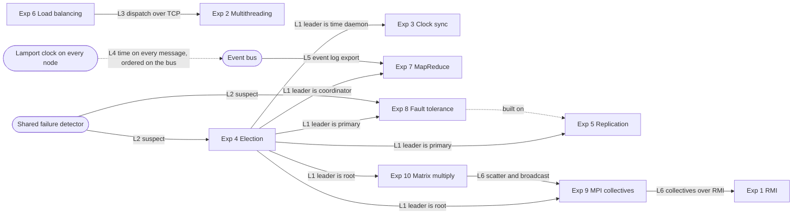

# UDCF architecture overview

This page describes the system as built on `main`. The design record is
[docs/HANDOFF.md](../HANDOFF.md) (Sections 5 and 6); each experiment has its own page under
[docs/experiments/](../experiments/).

## 1. The big picture

UDCF (Unified Distributed Coordination Framework) is **one Spring Boot process** (Java 21, Spring Boot
3.3.5) that hosts a **cluster of nodes**: 5 in the default `local` profile, 3 in the `public` profile.
Each node is a `ClusterNode` object with its own Lamport clock, its own roles and its own **real
sockets** on `127.0.0.1`. Every message between nodes goes through the operating system's network stack
(RMI, UDP or TCP), so a crash, a refused connection or a timeout is real. All ten lab experiments are
modules running on this one shared cluster: crashing a node affects every module on it.

```text
 Browser (React 18 + Vite)
   │ REST /api/**                 │ STOMP over WebSocket /ws
   ▼                              ▼
 ┌──────────── UDCF backend: one Spring Boot process ─────────────┐
 │ Web        controllers, STOMP broker, CORS, Actuator            │
 │ Scenarios  scenario engine (com.udcf.scenario)                  │
 │ Modules    10 ExperimentModules in a ModuleRegistry             │
 │ Core       Cluster, ClusterEventBus, LamportClock, RoleProvider,│
 │            FailureDetector, metrics                             │
 │ Nodes 1..N, each binding 127.0.0.1:                             │
 │   RMI 110k · clock UDP 600k · election UDP 700k                 │
 │   replication TCP 710k · requests TCP 720k · mapreduce TCP 730k │
 └─────────────────────────────────────────────────────────────────┘
```

There is no database: all state is in memory, and a cluster reset returns everything to a clean slate.

### Nodes and their lifecycle (`com.udcf.core.cluster`)

- `Cluster` builds nodes 1..N from `udcf.cluster` (size, capacity pattern, port bases).
- A module's service on a node is a `NodeService`, started **lazily** the first time the module needs it
  (`ClusterNode.ensureService`).
- `crash()` crashes every running service on the node (sockets close, RMI objects are unexported), sets
  the node to CRASHED and clears its roles; peers see a dead process on every protocol. `recover()`
  restarts the services that were running. A node's Lamport clock survives both (modelled as stable
  storage).
- Capacities (`NodeCapacity`): FAST = 4 threads, ×1 work; MEDIUM = 2 threads, ×2; SLOW = 1 thread, ×4.
  Local nodes 1 to 5 are FAST, MEDIUM, SLOW, MEDIUM, FAST.
- Reset (`ClusterResetService`, `POST /api/cluster/reset`): refused with 409 while any module is BUSY;
  otherwise it recovers all nodes, resets every module, resets every Lamport clock, clears the event
  history and publishes `CLUSTER_RESET`.

### REST and STOMP (`com.udcf.web`)

- REST: `/api/system/health` and `/info`, `/api/cluster` (crash, recover, reset), `/api/modules`,
  `/api/events` and `/api/events/export`, `/api/scenarios`, and each module under `/api/modules/<id>`.
  Errors are RFC 7807 problem details (for example 409 "Module busy", 409 "No leader").
- STOMP over a native WebSocket at `/ws`, simple broker on `/topic`: every event goes to
  `/topic/events`; cluster events also go to `/topic/cluster`, and module events to
  `/topic/modules/<id>`.
- CORS and the WebSocket handshake accept only the origins in `UDCF_ALLOWED_ORIGINS` (default
  `http://localhost:5173,http://127.0.0.1:5173`).

### The event bus and Lamport ordering (`com.udcf.core.events`, `com.udcf.core.clock`)

- `LamportClock`: `tick()` before a local event or a send; `update(t)` = `max(local, t) + 1` on receipt.
  Each node has one clock shared by all its modules; cluster-level events (node 0) use a separate
  cluster clock.
- `ClusterEventBus.publish` gives every event a **bus sequence number** (arrival order), stores it in a
  ring buffer (5000 events locally, 1500 public) and dispatches it to subscribers on its own thread,
  never blocking the publisher.
- A `ClusterEvent` holds the sequence, module, node id, type, Lamport time, wall time (display only),
  peer, message and data.
- **Causal order** is `(lamportTime, nodeId)`, then sequence. The Timeline page shows it by default
  ("Lamport order") and can switch to "Arrival order (bus sequence)". A role-change event carries the new
  holder's Lamport time while `LEADER_CHANGED` carries the cluster clock, so "this happened after the
  election" is read from the bus sequence, not from Lamport order.
- `EventLogExporter` turns events into text lines for MapReduce (link L5).

### The role provider and the leader (`RoleProvider`, `LeaderElector`)

- Experiment 4's `ElectionModule` is the only `LeaderElector`. When every live node agrees on one
  coordinator it calls `Cluster.assignLeader`, giving that node the `LEADER` role and publishing
  `LEADER_CHANGED`. Automatic elections run Bully, which elects the highest live node.
- `RoleProvider` is the single source of truth for roles (link L1):
  - `leaderId()` only reads; **a read never starts an election**.
  - `ensureLeader()` is called on request threads only. If there is no leader it asks for one election
    and waits at most the election bound (900 + 2200 = 3100 ms). If none is elected the module answers
    HTTP 409 with reason `NO_LEADER`, never a fallback node.
  - Leader listeners run on the `udcf-roles-dispatcher` thread, in announcement order.
- `NodeRole` has three values: `LEADER`, `PRIMARY`, `BACKUP`. The time daemon (Exp 3), MapReduce
  coordinator (Exp 7) and MPI root (Exps 9, 10) are module state that follows the leader, announced by
  `TIME_DAEMON_CHANGED`, `COORDINATOR_CHANGED` and `MPI_ROOT_CHANGED`.
- After a reset no node holds a role until a module asks for the leader.

### The failure detector (`com.udcf.core.failure`)

`FailureDetector` runs per node on the election UDP channel: a heartbeat to every peer every 700 ms, and
a peer silent for more than 2500 ms is suspected (`PEER_SUSPECTED`, then `PEER_ALIVE` when it is heard
again). Experiments 4 and 8 listen to the same detector (link L2).

## 2. Modules and links

| Lab | Module id | Page | Experiment page |
|---|---|---|---|
| 1 | `rmi` | `/experiments/1-rmi` | [exp01-rmi.md](../experiments/exp01-rmi.md) |
| 2 | `multithreading` | `/experiments/2-multithreading` | [exp02-multithreading.md](../experiments/exp02-multithreading.md) |
| 3 | `clocksync` | `/experiments/3-clocksync` | [exp03-clocksync.md](../experiments/exp03-clocksync.md) |
| 4 | `election` | `/experiments/4-election` | [exp04-election.md](../experiments/exp04-election.md) |
| 5 | `replication` | `/experiments/5-replication` | [exp05-replication.md](../experiments/exp05-replication.md) |
| 6 | `loadbalancing` | `/experiments/6-loadbalancing` | [exp06-loadbalancing.md](../experiments/exp06-loadbalancing.md) |
| 7 | `mapreduce` | `/experiments/7-mapreduce` | [exp07-mapreduce.md](../experiments/exp07-mapreduce.md) |
| 8 | `faulttolerance` | `/experiments/8-faulttolerance` | [exp08-faulttolerance.md](../experiments/exp08-faulttolerance.md) |
| 9 | `mpi` | `/experiments/9-mpi` | [exp09-mpi.md](../experiments/exp09-mpi.md) |
| 10 | `matrix` | `/experiments/10-matrix` | [exp10-matrix.md](../experiments/exp10-matrix.md) |



| Link | What it does | Where it is wired | Test that proves it |
|---|---|---|---|
| L1 | The leader elected by Exp 4 is the Berkeley time daemon (3), replication primary (5, 8), MapReduce coordinator (7) and MPI and matrix root (9, 10) | `RoleProvider.ensureLeader()` in each module | `LeaderRolesIntegrationTest`, `ClockSyncLeaderIntegrationTest`, `MapReduceLeaderIntegrationTest`, `LeaderFailoverIntegrationTest`, `LeaderCrashEndToEndTest` |
| L2 | Exps 4 and 8 act on the same failure-detector suspicion | Both register a listener on `ElectionNodeService.failureDetector()` | `LeaderFailoverIntegrationTest` |
| L3 | Exp 6 dispatches into each node's Exp 2 executor | `TcpWorkerTransport` → `RequestsClient` → `RequestsNodeService` | `L3LoadBalancingIntoExecutorsIntegrationTest` |
| L4 | Every inter-node message carries the sender's Lamport time, and the receiver calls `update` (heartbeats are the one deliberate exception) | Message headers (UDP, TCP) and `CallContext` (RMI) | `L4LamportOnMessagesIntegrationTest` |
| L5 | The live event log feeds MapReduce | `EventLogExporter` → `RunInputLoader`; `GET /api/events/export` | `L5EventExportToMapReduceIntegrationTest` |
| L6 | Exp 10 uses Exp 9 collectives over Exp 1 RMI | `RmiExtraExport`, `RmiCollectiveTransport`, `ParallelMatrixExecutor` | `L6MatrixOverCollectivesOverRmiIntegrationTest` |

The Overview page in the UI draws these six links live ("How the ten experiments work as one system")
and shows, for each, either live evidence or the test that verifies it.

## 3. Transports

Port of node k = base + k. Bases come from `udcf.cluster.ports` in `application.yml`.

| Service | Protocol | Ports (local, 5 nodes) | Experiments | Why this transport |
|---|---|---|---|---|
| RMI registry and remote objects | Java RMI over TCP | 1101–1105 | 1, 9, 10 | Experiment 1 is RMI by definition; 9 and 10 reuse it so collectives and the matrix run are real remote calls (L6). |
| Clock | UDP | 6001–6005 | 3 | Polls and Lamport messages are small and frequent; a lost datagram is handled by a timeout (an unresponsive node is listed, not waited for). |
| Election and heartbeats | UDP | 7001–7005 | 4 (and 8 through the detector) | Election messages and heartbeats are small and periodic, and the protocols already rely on timeouts: a missing reply *is* the signal. |
| Replication | TCP | 7101–7105 | 5, 8 | A write needs a definite acknowledgement and an immediate error when a backup is gone; failover updates need reliable, ordered delivery. |
| Requests | TCP | 7201–7205 | 2 (target), 6 (sender) | Each request needs a reply with its status (completed or rejected), so the balancer can reroute. |
| MapReduce worker | TCP | 7301–7305 | 7 | Task payloads can be large and must arrive complete with a result reply; a failed connection triggers a retry elsewhere. |

The browser talks to the backend only over HTTP on port 8080 (REST and the `/ws` WebSocket). The
internal ports are bound to `127.0.0.1` and never exposed.

## 4. The scenario engine (`com.udcf.scenario`)

A scenario is a scripted run on the real cluster that injects a failure, narrates each step and checks
what actually happened.

- `ScenarioEngine` runs one scenario at a time on the thread `udcf-scenario-runner`. Every run starts with
  a clean cluster reset, retried for up to 20 s while a module is busy. If the reset fails, every step is
  skipped and the verdict starts "Failed before the first step".
- A scenario is an ordered list of `ScenarioStep`s (narration, deadline, body). Waits inside a step share
  its deadline (30 s by default). A step passes only if what it observed matches its expectation; after a
  failure the remaining steps are skipped. Narration is fixed text; every number shown comes from
  observation.
- Verdicts: "Passed: all N steps met their expectations." or "Failed at step N: <reason>". The run ends
  with the cluster as it is (no automatic reset), so it can be inspected; the last 10 runs are kept in
  memory.
- API: `GET /api/scenarios`, `POST /api/scenarios/{id}/runs` (202; 409 while another runs),
  `GET /api/scenarios/runs/latest`, `GET /api/scenarios/runs/{runId}`. Events (module `scenario`):
  `SCENARIO_STARTED`, `STEP_STARTED`, `STEP_PASSED`, `STEP_FAILED`, `STEP_SKIPPED`, `SCENARIO_FINISHED`.

| Scenario | Steps | Modules |
|---|---|---|
| The leader dies mid-write | 6 | election, replication, faulttolerance |
| Split-brain that never happens | 7 | election, replication, faulttolerance |
| A slow node under load | 3 | multithreading, loadbalancing |
| Analyse the incident with MapReduce | 7 | election, mapreduce |
| The leader dies during a matrix multiply | 5 | election, rmi, mpi, matrix |

The Scenarios page (`/scenarios`) lists them with a Run button, a live step rail, the verdict, the end
state and a link to the Timeline.

## 5. Local profile versus public profile

| | `local` (default) | `public` |
|---|---|---|
| Purpose | The full demo on a laptop | The lite deployment on Render's free tier (512 MB RAM) |
| Cluster size | 5 (FAST, MEDIUM, SLOW, MEDIUM, FAST) | 3 (FAST, MEDIUM, SLOW) |
| Event buffer | 5000 | 1500 |
| Actuator endpoints | health, info, metrics, prometheus | health, info |
| Smaller limits | none | for example RMI hash rounds 100000, Exp 2 queue 100, matrix sizes 25, 50, 100, MPI payload 10000 elements, Exp 8 update budget 200, Exp 6 request and work caps |

The public deployment runs the backend as a Docker web service on Render (`render.yaml`,
`backend/Dockerfile`, `SPRING_PROFILES_ACTIVE=public`, JVM options in `JAVA_TOOL_OPTIONS`) and the
frontend as a static build on Vercel (`frontend/vercel.json`). A free Render instance sleeps after 15
minutes without visitors; the frontend then shows a "waking up" banner until `/api/system/health`
answers. Details: [docs/deploy/public-deploy.md](../deploy/public-deploy.md).

## 6. What is real and what is simulated

Real: every inter-node message crosses a real socket; every latency, count and timing on the pages is
measured; crashes close real sockets; executor work is real SHA-256 computation.

Simulated, and labelled with a "Simulated" badge and its reason on the page:

- the co-hosting of all nodes in one process on one machine (Experiments 1, 8, 9, 10 say so explicitly);
- the Berkeley clock offsets and drift rates (Experiment 3), because one machine has one hardware clock;
- the 450 ms asynchronous push delay (Experiments 5 and 8), standing in for network latency;
- the waiting workloads "Waiting (IO)" and the waiting half of "Mixed" in Experiment 2 (a sleep).
